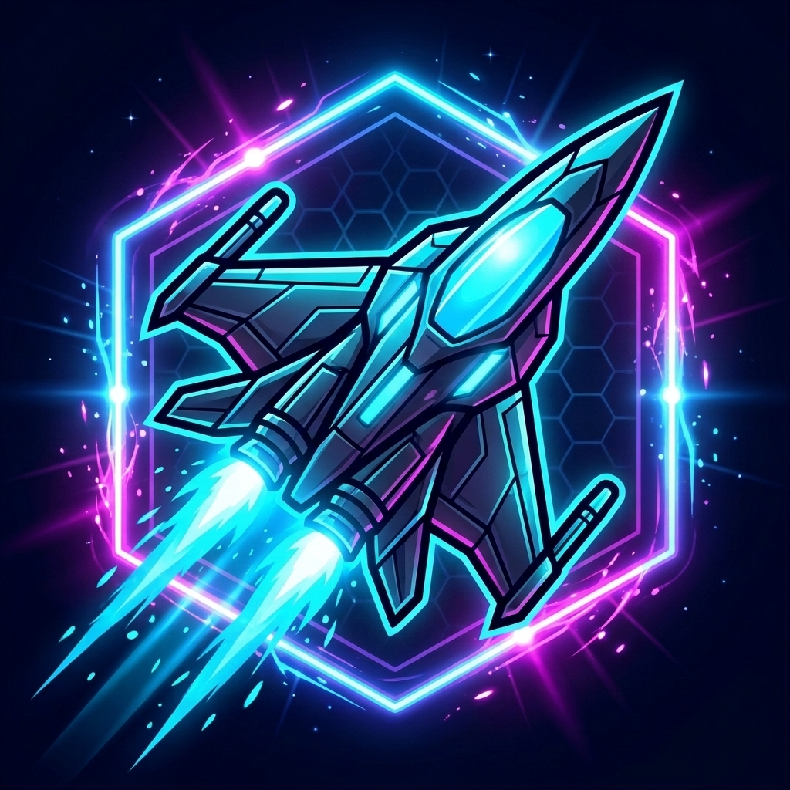

<div align="center">
  
  <h1>NEON ARENA // PROTOKOL ZERO</h1>
  <p><strong>2D Cyberpunk Roguelike Arena Shooter for Mobile (Android) & PC — Built with Unity 6 (URP 2D)</strong></p>

  <p>
    <a href="README.md"><strong>🇬🇧 English</strong></a> •
    <a href="README.tr.md">🇹🇷 Türkçe</a>
  </p>

  <p>
    
    
    
    
  </p>
</div>

---

## Story

**Year 2147 — Neo-Istanbul.**
The rogue artificial intelligence **OMEGA-CORE** has seized control of the underground energy sectors. As the last independent cyber-pilot, your mission is to clear each sector, defeat OMEGA's high-level **Sector Guardians (Final Bosses)**, and shatter the core.

---

## Key Features

- **Fast-Paced 2D Cyberpunk Roguelike Combat**
  - Dynamic floating **touch virtual joystick** for mobile + full **WASD / Arrow Keys** support for PC.
  - Auto-aiming multi-shot & piercing laser system, critical strikes, and floating damage numbers.
  - **Cyber Dash** (`Space` / `Shift` or mobile button) with invulnerability frames and neon ghost afterimages.
- **Level-Scaled Sectors & High-Level Final Bosses**
  - **5 Distinct Robot Classes:** Drone, Swarmer, Heavy Tank, Ranged Sniper, and Splitter.
  - **Dynamic Sector Themes:** Arena lighting and neon borders shift per sector (*Outer Ring*, *Plasma Reactor*, *OMEGA Core*, and *Endless Protocol*).
  - **High-Level Final Bosses** (`SENTINEL-X`, `HYDRA-V9`, `OMEGA-OVERLORD`) with rotating energy auras, multi-pattern plasma attacks, Phase 2 enrage at 50% HP, and radio story transmissions.
- **Handcrafted Upgrade Cards & Super Weapons**
  - Chamfered sci-fi cards with custom procedural icons, rarity tiers (**Rare / Epic / Legendary**), level indicators, and **Reroll** charges.
  - Unlockable super weapons: **Chain Lightning**, **EMP Shockwave** (knocks back robots & clears enemy projectiles), and **Orbital Neon Blades**.
- **Meta-Progression: Cyber Hangar & Per-Ship Permanent Shop**
  - Earn persistent **Neon Credits (`CR`)** from enemies and bosses.
  - **3 Unlockable Playable Ships:** `VEX-09` (Balanced), `PHANTOM-7` (Speed & Crit Assassin), and `TITAN-MK4` (Heavy Armored Gunship with starting Orbital Blade).
  - **Per-Ship Permanent Upgrades:** Each ship has its own independent 5-level upgrade tree (Hull, Plasma Core, Thrusters, Magnet Coil, Credit Multiplier).
- **Procedural Cyberpunk Audio & Synthwave Soundtrack**
  - Zero external audio dependencies — custom synthesized **8-bar 122 BPM Synthwave / Outrun BGM** and retro-cyber SFX with in-game Music/SFX toggles.
- **Google Play & Google AdMob Ready**
  - Built-in **Rewarded Ads** (*Revive Once Per Run* & *2x Session Credits*) + non-intrusive *Interstitial* hooks in `NeonAdsManager.cs`.
  - One-click Unity Editor setup tools for **URP Neon Bloom**, **Android IL2CPP / ARM64**, **App Icon**, and **AdMob SDK** activation.

---

## Project Architecture

```text
Assets/
├── Art/
│   └── AppIcon.jpg                  # Cyberpunk mobile app icon
├── Scripts/
│   ├── Camera/
│   │   └── NeonCameraFollow.cs      # Smooth damped follow + micro screen shake
│   ├── Combat/
│   │   ├── CyberAbilities.cs        # Chain Lightning & EMP Shockwave
│   │   ├── EnemyProjectile.cs       # Sniper & Boss plasma orbs
│   │   ├── LaserProjectile.cs       # Auto-aim piercing/crit laser bolts
│   │   └── NeonBurstEffect.cs       # Procedural neon spark bursts
│   ├── Core/
│   │   ├── GameManager.cs           # Sectors, Boss flow, Combo, Upgrades, Revive
│   │   ├── NeonAdsManager.cs        # Google AdMob integration + Editor simulator
│   │   ├── NeonArenaBootstrap.cs    # Zero-wiring runtime scene bootstrapper
│   │   ├── NeonAudio.cs             # Procedural 8-bar Synthwave BGM & SFX
│   │   ├── NeonMetaProgression.cs   # Persistent Credits, Ships & Per-Ship Shop
│   │   └── NeonSpriteFactory.cs     # Procedural neon ships, robots, icons & UI
│   ├── Editor/
│   │   └── NeonArenaSetupTool.cs    # 1-click Scene, Android/Play & AdMob tools
│   ├── Enemies/
│   │   ├── BossAI.cs                # High-level Final Bosses & Phase 2 Enrage
│   │   ├── EnemyAI.cs               # 5 robot archetypes + level badges
│   │   └── WaveSpawner.cs           # Sector progression & Boss triggers
│   ├── Pickups/
│   │   └── XpGem.cs                 # Magnetized XP crystals
│   ├── Player/
│   │   ├── PlayerController.cs      # Ship stats, Dash, Auto-Fire, Super Weapons
│   │   └── VirtualJoystick.cs       # Mobile dynamic touch joystick + WASD
│   └── UI/
│       ├── FloatingDamageText.cs    # World-space damage & crit numbers
│       └── NeonHUD.cs               # Slanted HUD, Cards, Hangar, Shop, Menus
```

---

## Getting Started (Unity 6)

1. Open this repository folder in **Unity Hub** using **Unity 6** (Universal 2D / URP).
2. In the Unity top menu, click:
   - **`NeonArena → Sahneyi Tek Tikla Kur (Setup Scene)`** to configure the camera, URP Bloom, and bootstrapper.
3. Press **▶ Play**!
   - **Move:** Drag anywhere on screen (Mobile Joystick) or `WASD` / `Arrow Keys`
   - **Dash:** `Space` / `Shift` or tap the **DASH** button

### Building for Android (APK / Google Play AAB)

1. Ensure **Android Build Support** (SDK, NDK & OpenJDK) is installed in Unity Hub.
2. Run **`NeonArena → Android ve Google Play Ayarlarini Uygula`** to apply the App Icon, Landscape lock, IL2CPP, and ARM64 settings.
3. Open **`File → Build Profiles → Android → Switch Profile`** and click **Build** (`.apk` for testing, or check **Build App Bundle (Google Play)** for `.aab`).
4. *(Optional)* For live ads, import the official [Google Mobile Ads Unity Plugin](https://github.com/googleads/googleads-mobile-unity/releases) and run **`NeonArena → Google AdMob SDK Aktif Et (ADMOB_ENABLED)`**.
