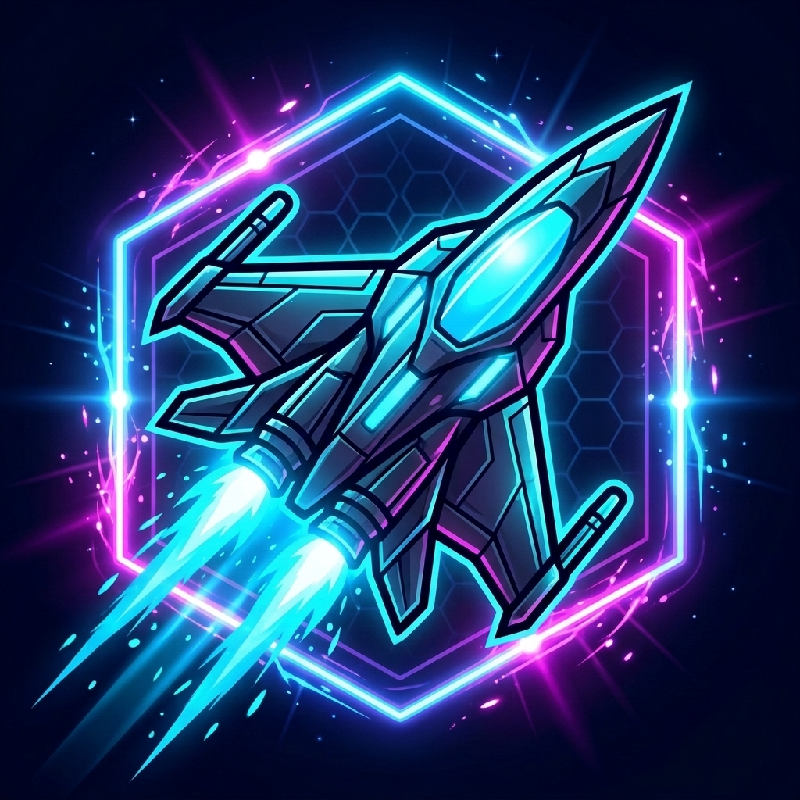

<div align="center">
  
  <h1>NEON ARENA // PROTOKOL ZERO</h1>
  <p><strong>Mobil (Android) ve PC için 2D Siberpunk Roguelike Arena Aksiyon Oyunu — Unity 6 (URP 2D)</strong></p>

  <p>
    <a href="README.md">🇬🇧 English</a> •
    <a href="README.tr.md"><strong>🇹🇷 Türkçe</strong></a>
  </p>

  <p>
    
    
    
    
  </p>
</div>

---

## Hikaye

**Yıl 2147 — Neo-İstanbul.**
Kontrolden çıkan dev yapay zeka ağı **OMEGA-CORE**, yeraltı enerji sektörlerinin tamamını ele geçirdi. Son bağımsız siber pilot olarak görevin; sektörleri robot dalgalarından temizlemek, OMEGA'nın yüksek seviyeli **Sektör Muhafızlarını (Final Boss)** yok etmek ve çekirdeği kırmak.

---

## Öne Çıkan Özellikler

- **Akıcı 2D Siberpunk Roguelike Savaş Sistemi**
  - Mobil için ekrana dokunulan yerde açılan **dinamik sanal joystick** + PC'de **WASD / Ok Tuşları** desteği.
  - En yakın robota otomatik nişan alan çoklu & delici lazer sistemi, kritik vuruşlar ve uçuşan hasar sayıları.
  - **Siber DASH** (`Space` / `Shift` veya mobil buton): kısa süreli dokunulmazlık ve arkada neon hayalet izi.
- **Seviye Seviye Sektörler & Yüksek Seviyeli Final Boss'lar**
  - **5 Farklı Robot Sınıfı:** Drone, Hızlı Swarmer, Ağır Tank, Keskin Nişancı (Sniper) ve Bölünen (Splitter).
  - **Dinamik Sektör Temaları:** Her sektörde (*Dış Çember*, *Plazma Reaktörü*, *OMEGA Çekirdeği* ve *Sonsuz Protokol*) arena renk teması değişir.
  - **Yüksek Seviyeli Final Boss'lar** (`SENTINEL-X`, `HYDRA-V9`, `OMEGA-OVERLORD`): dönen enerji aurası, çoklu plazma saldırı paternleri, %50 canda **Öfkeli Faz 2** ve telsiz hikaye diyalogları.
- **Özel Tasarım Yükseltme Kartları & Süper Silahlar**
  - Kesilmiş köşeli siberpunk kartlar, özel prosedürel ikonlar, nadirlik katmanları (**Nadir / Epik / Efsanevi**), seviye göstergesi ve **Kart Yenileme (Reroll)** hakkı.
  - Açılabilir süper silahlar: **Zincir Yıldırım**, **EMP Şok Dalgası** *(robotları iter ve düşman mermilerini havada siler)* ve **Yörünge Bıçakları**.
- **Kalıcı İlerleme: Siber Hangar & Gemiye Özel Mağaza**
  - Robot ve Boss imhalarından kalıcı **Neon Kredi (`CR`)** kazanımı.
  - **3 Oynanabilir Gemi:** `VEX-09` (Dengeli), `PHANTOM-7` (Hız & Kritik Suikastçısı) ve `TITAN-MK4` (Ağır Zırhlı Savaş Gemisi — 1 Yörünge Bıçağı ile başlar).
  - **Gemiye Özel Kalıcı Mağaza:** Her geminin kendi bağımsız 5 seviyelik yükseltme ağacı vardır *(Gövde Zırhı, Plazma Çekirdeği, İtici Motorlar, Mıknatıs Bobini, Kredi Çarpanı)*.
- **Prosedürel Synthwave Müzik & Siberpunk Ses Efektleri**
  - Dış ses dosyasına ihtiyaç duymadan kodla üretilen **8 barlık 122 BPM Synthwave / Outrun** arka plan müziği, siber ses efektleri ve Duraklat menüsünde Müzik/Ses aç-kapa ayarları.
- **Google Play & Google AdMob Hazır Altyapı**
  - **Ödüllü Reklamlar** (*Koşu Başına 1 Kez Canlan* & *2x Neon Kredi*) + her 3 oyunda bir geçiş reklamı (`NeonAdsManager.cs`).
  - **URP Neon Bloom**, **Android IL2CPP / ARM64**, **Uygulama İkonu** ve **AdMob SDK** için tek tıkla çalışan Unity Editor araçları.

---

## Proje Mimarisi

```text
Assets/
├── Art/
│   └── AppIcon.jpg                  # Siberpunk mobil uygulama ikonu
├── Scripts/
│   ├── Camera/
│   │   └── NeonCameraFollow.cs      # Yumuşak kamera takibi + ekran sarsıntısı
│   ├── Combat/
│   │   ├── CyberAbilities.cs        # Zincir Yıldırım ve EMP Şok Dalgası
│   │   ├── EnemyProjectile.cs       # Sniper ve Boss plazma mermileri
│   │   ├── LaserProjectile.cs       # Otomatik nişan delici/kritik lazerler
│   │   └── NeonBurstEffect.cs       # Prosedürel neon patlama kıvılcımları
│   ├── Core/
│   │   ├── GameManager.cs           # Sektörler, Boss akışı, Kombo, Yükseltmeler
│   │   ├── NeonAdsManager.cs        # Google AdMob yöneticisi + Editor simülatörü
│   │   ├── NeonArenaBootstrap.cs    # Sahneyi çalışma anında kuran başlatıcı
│   │   ├── NeonAudio.cs             # Prosedürel 8-bar Synthwave müzik & SFX
│   │   ├── NeonMetaProgression.cs   # Kalıcı Kredi, Gemiler & Gemiye Özel Mağaza
│   │   └── NeonSpriteFactory.cs     # Prosedürel neon gemi, robot, ikon & UI
│   ├── Editor/
│   │   └── NeonArenaSetupTool.cs    # Tek tıkla Sahne, Android/Play & AdMob araçları
│   ├── Enemies/
│   │   ├── BossAI.cs                # Yüksek seviyeli Final Boss'lar & Faz 2
│   │   ├── EnemyAI.cs               # 5 robot sınıfı + seviye rozetleri
│   │   └── WaveSpawner.cs           # Sektör ilerlemesi & Boss çağırıcı
│   ├── Pickups/
│   │   └── XpGem.cs                 # Mıknatıslı XP kristalleri
│   ├── Player/
│   │   ├── PlayerController.cs      # Gemi statları, Dash, Otomatik Ateş, Silahlar
│   │   └── VirtualJoystick.cs       # Mobil dinamik dokunmatik joystick + WASD
│   └── UI/
│       ├── FloatingDamageText.cs    # Uçuşan hasar ve kritik sayıları
│       └── NeonHUD.cs               # Eğimli HUD, Kartlar, Hangar, Mağaza, Menüler
```

---

## Kurulum ve Çalıştırma (Unity 6)

1. Bu proje klasörünü **Unity Hub** üzerinden **Unity 6** (Universal 2D / URP) ile açın.
2. Unity üst menüsünden **`NeonArena → Sahneyi Tek Tikla Kur (Setup Scene)`** seçeneğine tıklayın.
3. **▶ Play** tuşuna basın!
   - **Hareket:** Ekranda sürükleme (Mobil Joystick) veya `WASD` / `Ok Tuşları`
   - **Dash:** `Space` / `Shift` veya **DASH** butonu

### Android Derleme (APK / Google Play AAB)

1. Unity Hub'da **Android Build Support** (SDK, NDK & OpenJDK) modülünün kurulu olduğundan emin olun.
2. **`NeonArena → Android ve Google Play Ayarlarini Uygula`** menüsünü çalıştırın *(İkon, Yatay kilit, IL2CPP ve ARM64 otomatik ayarlanır)*.
3. **`File → Build Profiles → Android → Switch Profile`** sonrası **Build** alın *(test için `.apk`, Google Play için **Build App Bundle (Google Play)** seçerek `.aab`)*.
4. *(İsteğe bağlı)* Gerçek reklamlar için resmi [Google Mobile Ads Unity Eklentisi](https://github.com/googleads/googleads-mobile-unity/releases)'ni içe aktarıp **`NeonArena → Google AdMob SDK Aktif Et (ADMOB_ENABLED)`** menüsünü çalıştırın.
